# Introduction
ModelingToolkitTolerances.jl is designed to help with the selection of `abstol` and `reltol` (see [stepsize control](https://docs.sciml.ai/DiffEqDocs/stable/basics/common_solver_opts/) for more info) when using ModelingToolkit.jl and DifferentialEquations.jl to solve models. These tolerances act on the error estimates computed when solving the model.  These error estimates are very abstract from the physics of the problem and are therefore challenging to set in some cases.  As can be seen from the documentation, the defaults for `abstol` and `reltol` are 1e-6 and 1e-3, respectively.  If these defaults give a bad result, how should they be adjusted?  It's very difficult to know what to do in this case, and that is where ModelingToolkitTolerances.jl seeks to help.  

Furethermore, in some cases it's sometimes obvious if a model solution was good or bad, but in other cases the question arrises: What is the quality of the model solution?  What is it's "error"?  With the knowledge that we have from a ModelingToolkit.jl model in addition to the power of Automatic Differentiation, we can now solve for the model error, and even check the error of each solved equation, whether it was algebraic or differential.  One of the easiest ways to use this package is to simply check the quality of a model solution.  This can be done in a few different ways.  

## Graphically
Take the following simple ODE of $x′ = x/4$.  If we use the `Euler` method with a large step size, we know that this will provide a low quality solution.  Let's take a look at the solution with a step size of 2s.

```julia
using ModelingToolkit, OrdinaryDiffEq, OrdinaryDiffEqLowOrderRK, Plots
using ModelingToolkit: D_nounits as D, t_nounits as t
vars = @variables x(t)=1
eq = D(x) ~ x/4
@mtkcompile sys = System([eq], t, vars, [])
prob = ODEProblem(sys, [], (0, 10))
sol = solve(prob, Euler(); dt=2, adaptive=false)
plot(sol; idxs=x)
```

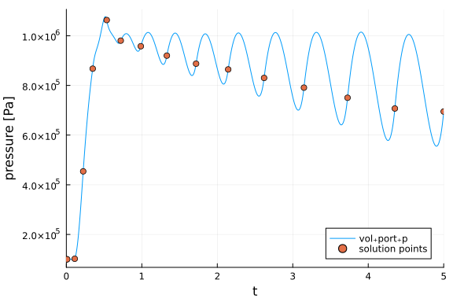


Without the analytical solution, we don't know how to quantify the error.  With `ModelingToolkitTolerances` we can now estimate this error.  This can be seen visually by adding `true` (or a number to represent the residual limit) to the 2nd argument of `plot(sol::ODESolution, residual_settings::Union{Bool, Real}; kwargs...)`

```julia
using ModelingToolkitTolerances
plot_with_residual(sol; idxs=x) # residual limit defaults to 1.0
```

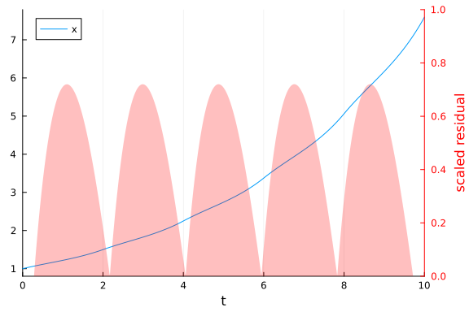


## Numerically
To get the residual information directly we can use the function `residual(sol::ODESolution)`...

```julia
res = residual(sol)
plot(res; yscale=:identity)
```

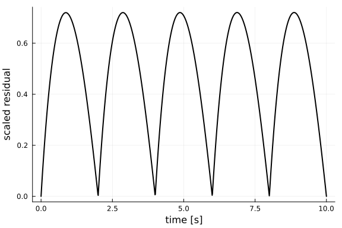


We can convert this to a single number by taking the `maximum` of the `scaled_norm`.

```julia
r = maximum(scaled_norm(res))
```

```
0.7202878845463089
```


When using models in an algrithm, say in a loss function for example, it's a good idea to add this to a quality check.  For example...

```julia
residual_limit = 0.1
accept_result = (sol.retcode == ReturnCode.Success) && (maximum(scaled_norm(residual(sol))) < residual_limit)
```

```
false
```


If we decrease the step size we should get a better result.  Now we see an acceptable result...

```julia
sol = solve(prob, Euler(); dt=0.1, adaptive=false)
res = residual(sol)
r = maximum(scaled_norm(res)) # 0.046
accept_result = (sol.retcode == ReturnCode.Success) & (r < residual_limit) # true
plot_with_residual(sol; idxs=x)
```

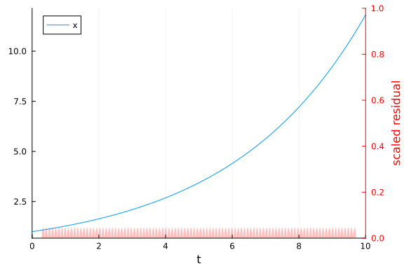


# Using ModelingToolkitTolerances 
## How to explore tolerance settings
Take the following hydraulic model of a pressure source, connected to a fixed volume with a valve.  The valve starts closed and then opens with a linear ramp.  We would expect to see the pressure in the volume rise smoothly, quickly and then slowly, in an S shaped ramp, tabling off at a constant pressure matching the source.  

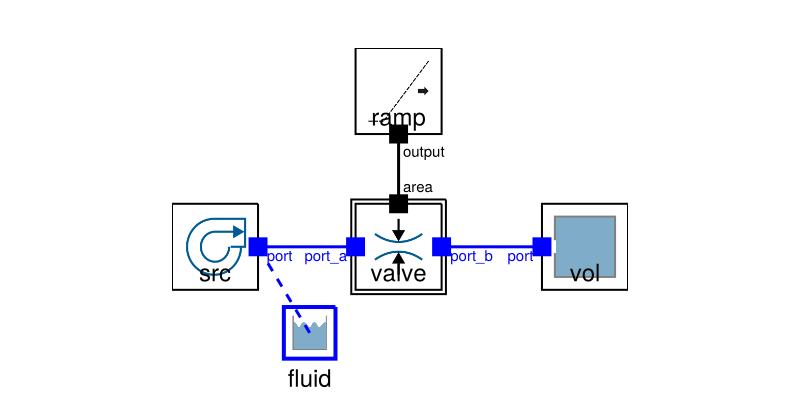

Let's see what we get when we solve this model...

```julia
using ModelingToolkit, OrdinaryDiffEq
using ModelingToolkit: t_nounits as t, D_nounits as D
import ModelingToolkitStandardLibrary.Hydraulic.IsothermalCompressible as IC
import ModelingToolkitStandardLibrary.Blocks as B

using Plots

function ValveVolume(; name)
    pars = []

    systems = @named begin
        fluid = IC.HydraulicFluid()
        src = IC.FixedPressure(; p = 10e5)
        vol = IC.FixedVolume(; vol = 5, p_int=1e5)
        valve = IC.Valve(; Cd = 1e5, minimum_area = 0)
        ramp = B.Ramp(; height = 0.1, duration = 0.1, offset = 0, start_time = 0.1, smooth = true)
    end

    eqs = [connect(fluid, src.port)
           connect(src.port, valve.port_a)
           connect(valve.port_b, vol.port)
           connect(valve.area, ramp.output)]

    return System(eqs, t, [], pars; name, systems)
end

@mtkcompile sys = ValveVolume()
prob = ODEProblem(sys, [], (0, 5))
sol = solve(prob, Rodas5P()) # <-- using default abstol=1e-6 & reltol=1e-3
plot(sol; idxs=sys.vol.port.p, ylabel="pressure [Pa]")
scatter!(sol.t, sol[sys.vol.port.p]; label="solution points")
```

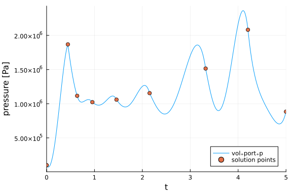


What we see here is a very strange solution which seems to be unstable.  Clearly we have an invalid solution.  Let's use ModelingToolkitTolerances.jl to see what the model error is...

```julia
using ModelingToolkitTolerances
resid = residual(sol, 0:0.01:5)
plot(resid; yscale=:identity)
```

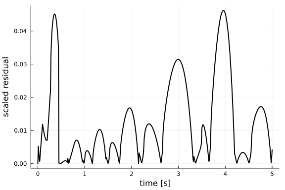


As can be seen, the error or residual of the model is quite larger than 0.  A perfect solution (i.e. an analytical solution) to the problem would give a residual of 0.  We can see then that this solution, as expected, is not high quality.  So what should we do to get a better solution?  Let's use ModelingToolkitTolerances.jl to explore what we can do using the `analysis` function...

```julia
resids = analysis(prob, Rodas5P())
```

```
:: [8%] analysis step: abstol=0.001, reltol=0.001
:: [17%] analysis step: abstol=0.001, reltol=1.0e-6
:: [25%] analysis step: abstol=0.001, reltol=1.0e-9
:: [33%] analysis step: abstol=0.001, reltol=1.0e-12
:: [42%] analysis step: abstol=1.0e-6, reltol=0.001
:: [50%] analysis step: abstol=1.0e-6, reltol=1.0e-6
:: [58%] analysis step: abstol=1.0e-6, reltol=1.0e-9
:: [67%] analysis step: abstol=1.0e-6, reltol=1.0e-12
:: [75%] analysis step: abstol=1.0e-9, reltol=0.001
:: [83%] analysis step: abstol=1.0e-9, reltol=1.0e-6
:: [92%] analysis step: abstol=1.0e-9, reltol=1.0e-9
:: [100%] analysis step: abstol=1.0e-9, reltol=1.0e-12
                         Summary of Max Scaled Residuals
┌────────┬────────────────┬─────────────────┬─────────────────┬──────────────────┐
│ abstol │ reltol = 0.001 │ reltol = 1.0e-6 │ reltol = 1.0e-9 │ reltol = 1.0e-12 │
├────────┼────────────────┼─────────────────┼─────────────────┼──────────────────┤
│  0.001 │          0.239 │         0.00535 │         0.00305 │          0.00314 │
│ 1.0e-6 │          0.208 │         0.00623 │         2.31e-5 │      * 1.39e-7 * │
│ 1.0e-9 │            N/A │             N/A │             N/A │              N/A │
└────────┴────────────────┴─────────────────┴─────────────────┴──────────────────┘
```


In plotted form...
```julia
plot(resids)
```

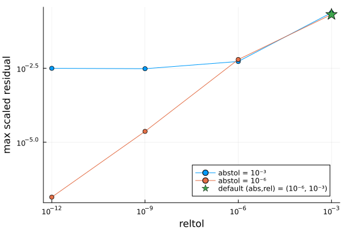


What we see here is that we need to adjust the `abstol` and `reltol` to 1e-6 and 1e-9 to get the residual to as close to zero as possible.  Let's apply that and 
see the new result.

```julia
sol = solve(prob, Rodas5P(); abstol=1e-6, reltol=1e-9)
plot(sol; idxs=sys.vol.port.p, ylabel="pressure [Pa]")
scatter!(sol.t, sol[sys.vol.port.p]; label="solution points")
```

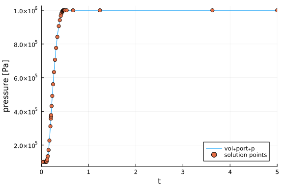


As can be seen we now get the expected smooth solution to a constant pressure.

## Work Precision
We can also get a work precision plot based on the calculated residual.

```julia
work_precision(resids)
```

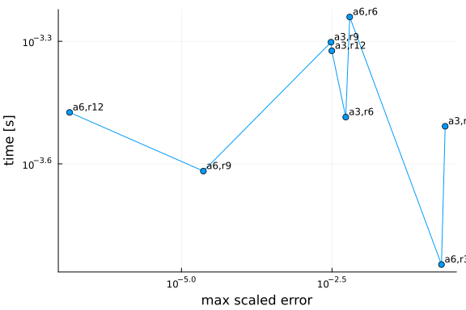


Here we can see that the point labeled "a6,r12" gives the optimal result, with a minimal residual and a very fast solve time to go with it.  Note the label represents the abstol and the reltol exponents, respectively.  Therefore, "a6,r12" is translated to "abstol=1e-6, reltol=1e-12".

## CPU Timing
Often areas of high error will also experience higher compute time.  It's also possible to gather this information by adding `true` as the 2nd positional argument to `solve`, for example

```julia
sol, cpu_timing = solve_with_cpu_time(prob, Rodas5P());
plot(cpu_timing)
```

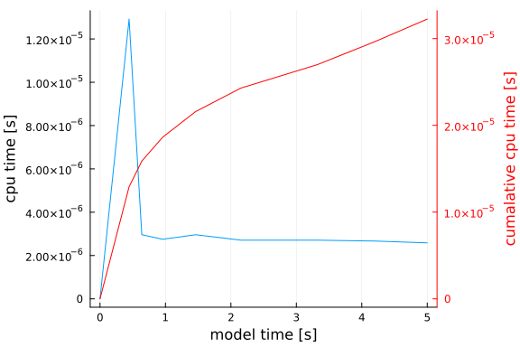


# How ModelingToolkitTolerances Works
The concept of `ModelingToolkitTolerances` is quite simple.  From `ModelingToolkit`, we know the symbolic representation of the equations, therefore we know where the derivatives in the system are.  Using `ForwardDiff` and the `ODESolution` function, we can easily obtain  derivatives numerically.  Pair those 2 things together and it's easy to calculate the residual of all equations in a system.  

Take the simple convection cooling model...

```julia
T_inf=300; h=0.7; A=1; m=0.1; c_p=1.2
vars = @variables begin
    T(t)=301
end 
eqs = [
    D(T) ~ (h * A) / (m * c_p) * (T_inf - T)
]
@mtkcompile sys = System(eqs, t, vars, [])
prob = ODEProblem(sys, [], (0, 10))
sol = solve(prob, Tsit5())
plot(sol; idxs=T)
```

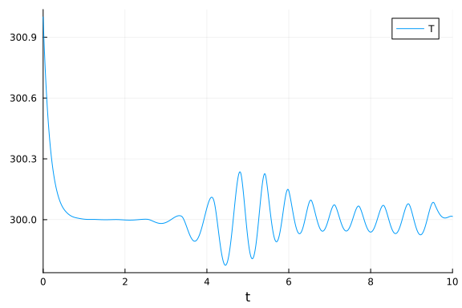


We are plotting the temperature, which should be smoothly cooling from 301K to 300K and reaching steady state.  But something in the numerical solution goes wrong and the temperature becomes unstable.  In this case we clearly have a measurable residual error in the solved equation.  The residual is calculated by simply taking the left hand side of the equation subtracted from the right hand side:

```julia
res = ( (h * A)/(m * c_p) * (T_inf - T) ) - ( D(T) )
```


From the numerical solution, we know `T`, but we don't have `D(T)`.  As mentioned, we can estimate this using `ForwardDiff`...

```julia
using ForwardDiff

Tsol(t) = sol(t; idxs=sys.T)
dTsol(t) = ForwardDiff.derivative(Tsol, t)
```


We can now calculate the residual as follows...

```julia
resf(t) = ( (h * A) / (m * c_p) * (T_inf - Tsol(t)) ) - ( dTsol(t) )

times = 0:1e-3:10
plot(times, resf; label="manual")
```


This is exactly what is computed automatically when asking for the `residual` from `ModelingToolkitTolerances`

```julia
res = residual(sol, times)
plot!(res.t, res.residuals[:,1]; label="ModelingToolkitTolerances")
```

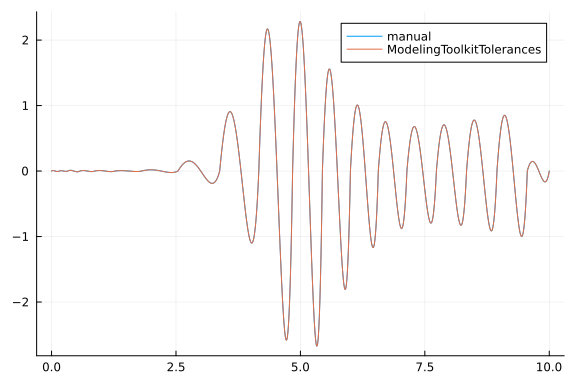


Note: calling `plot(info::ResidualInfo, settings::ResidualSettings = SUMMARY)` will plot the `scaled_norm` of all requested equations in `settings`.

Using the `analysis` function we can quickly find a better tolerance setting...

```julia
resids = analysis(prob, Tsit5())
```

```
:: [8%] analysis step: abstol=0.001, reltol=0.001
:: [17%] analysis step: abstol=0.001, reltol=1.0e-6
:: [25%] analysis step: abstol=0.001, reltol=1.0e-9
:: [33%] analysis step: abstol=0.001, reltol=1.0e-12
:: [42%] analysis step: abstol=1.0e-6, reltol=0.001
:: [50%] analysis step: abstol=1.0e-6, reltol=1.0e-6
:: [58%] analysis step: abstol=1.0e-6, reltol=1.0e-9
:: [67%] analysis step: abstol=1.0e-6, reltol=1.0e-12
:: [75%] analysis step: abstol=1.0e-9, reltol=0.001
:: [83%] analysis step: abstol=1.0e-9, reltol=1.0e-6
:: [92%] analysis step: abstol=1.0e-9, reltol=1.0e-9
:: [100%] analysis step: abstol=1.0e-9, reltol=1.0e-12
                         Summary of Max Scaled Residuals
┌────────┬────────────────┬─────────────────┬─────────────────┬──────────────────┐
│ abstol │ reltol = 0.001 │ reltol = 1.0e-6 │ reltol = 1.0e-9 │ reltol = 1.0e-12 │
├────────┼────────────────┼─────────────────┼─────────────────┼──────────────────┤
│  0.001 │          0.551 │          0.0022 │         0.00144 │          0.00144 │
│ 1.0e-6 │          0.547 │        0.000475 │         1.94e-6 │          1.55e-6 │
│ 1.0e-9 │          0.547 │        0.000481 │         4.61e-7 │      * 4.26e-9 * │
└────────┴────────────────┴─────────────────┴─────────────────┴──────────────────┘
```


```julia
plot(resids)
```

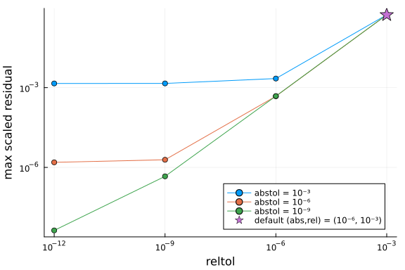


As can be seen, to get a residual less than 1 simply requires setting the `reltol` to `1e-6`.

```julia
sol = solve(prob, Tsit5(); reltol=1e-6)
plot(sol; idxs=T)
```

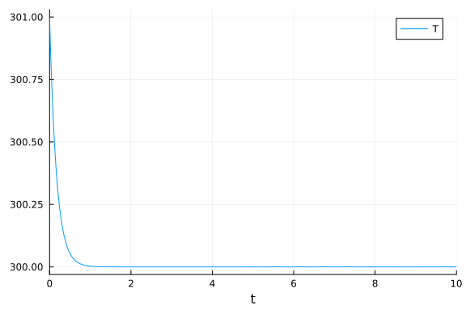


As can be seen, we now have a stable solution, as expected.

## Scaled Residual
Every equation has its own residual, in its own physical units.  A pressure equation might have a residual in Pa/s, while a flow equation has one in m³/s.  Adding these together with `norm` doesn't make physical sense, and large-valued equations would hide small-valued ones.  Instead, `scaled_norm` turns the residuals into one dimensionless number at each time.  It does this in 3 steps.

**1. Map the residual to a state error.**  The compiled model is in mass-matrix form $M u' = f(u, p, t)$, and the residual is $r = f(u) - M u'$.  To ask "how wrong are the states?", we take one Newton correction of an implicit step of size $dt$:

```math
\left( \frac{M}{dt} - J \right) \delta u = r, \qquad J = \frac{\partial f}{\partial u}
```

The Jacobian $J$ is computed with `ForwardDiff` at each time point.  The solved state error $\delta u_j$ has the same units as the unknown $u_j$.  For algebraic equations ($M_{ii} = 0$) this is simply $\delta u = J^{-1} r$.  For differential equations, the $M/dt$ term keeps the system solvable even when $J$ is singular, for example with a pure integrator like `D(x) ~ v`.  As $dt \to 0$, differential rows reduce to $\delta u \approx r \, dt$.

The time scale $dt$ defaults to the spacing of the time points passed to `residual()` (stored in `res.state_error_dt`).  It can be set explicitly with the `state_error_dt` keyword.

**2. Weight each state error the way the ODE solvers do.**

```math
e_i = \frac{\delta u_i}{\text{abstol}_i + \text{reltol} \, |u_i|}
```

The defaults are `abstol = 1e-6` and `reltol = 1e-3`, the same as the ODE solver defaults.  So a value of about 1 means the error the residual implies is about as large as the solver's default error tolerance.  Pass `reltol = 1` to get roughly the relative error in each state instead.  `abstol` can also be a vector with one entry per unknown.  This gives each variable its own nominal scale, like Modelica's `nominal` attribute.

**3. Combine the weighted errors.**  The default `p = 2` gives the RMS over the selected unknowns, which matches `DiffEqBase.ODE_DEFAULT_NORM`.  `p = Inf` gives the maximum instead.

For the convection model above there is 1 differential equation, so $M = 1$ and $J = -hA/(m c_p)$.  We can reproduce `scaled_norm` by hand from the `resf` function defined earlier...

```julia
res = residual(sol, times)  # residual of the current (reltol=1e-6) solution, matching `Tsol`
dt = res.state_error_dt  # 1e-3, the spacing of `times`
J = -(h * A) / (m * c_p)

δT(t) = resf(t) / (1/dt - J)
e(t) = abs(δT(t)) / (1e-6 + 1e-3 * abs(Tsol(t)))

plot(times, e; label="manual", ylabel="scaled residual")
plot!(res.t, scaled_norm(res); label="scaled_norm", linestyle=:dash)
```

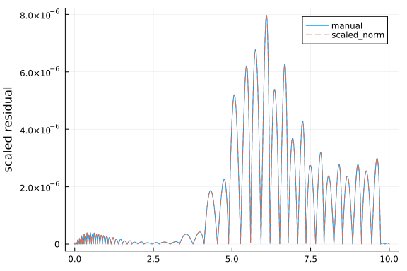


The scaled residual is what is shown by `plot(res)`, `plot(resids)`, `plot_with_residual()`, `work_precision()` and the `analysis()` summary table.

## Important Note
Using `saveat` can affect the quality of the `ForwardDiff.derivative` computed from the `ODESolution`.  Avoid setting this keyword when using `residual()` or `analysis()`.  

# API

```julia
residual(sol::ODESolution, tms = default_range(sol); abstol=0.0, reltol=0.0, timing=0.0)
```

Calculates residual information for `sol::ODESolution` coming from a `ModelingToolkit` model at the times `tms`, which defaults to the solved time points `sol.t`.  Returns as `ResidualInfo` object.

Keyword Arguments (used by `analysis() function`):

  * `abstol`: this simply records the `abstol` that was used to create `sol` object.  Since this information is not recorded in an `ODESolution` object it must be specified explicitly for reference.  Used by `analysis()` function.
  * `reltol`: same as above, but for `reltol`
  * `timing`: this records the corresponding solution time reference.  Used by `analysis()` function.
  * `state_error_dt`: time scale `dt` used to map residuals to state errors through `(M/dt - J) δu = r`.  Defaults to the spacing of `tms`.  See `scaled_norm()`.


```julia
analysis(prob::ODEProblem, solver, tms = collect(prob.tspan[1]:1e-3:prob.tspan[2]); kwargs...)
```

Runs a 3 x 4 study of `abstol` = [1e-3, 1e-6, 1e-9] and `reltol` = [1e-3, 1e-6, 1e-9, 1e-12].  Returns a `Vector{ResidualInfo}` which can be sent to `plot()` and `work_precision()` functions for visual analysis.  A `solver` from `OrdinaryDiffEq` must be passed as the 2nd argument.  The time points used for residual calculation are provided by `tms` and default to the `prob.tspan` spaced by 1ms.  Provided `kwargs...` are passed to the solve

